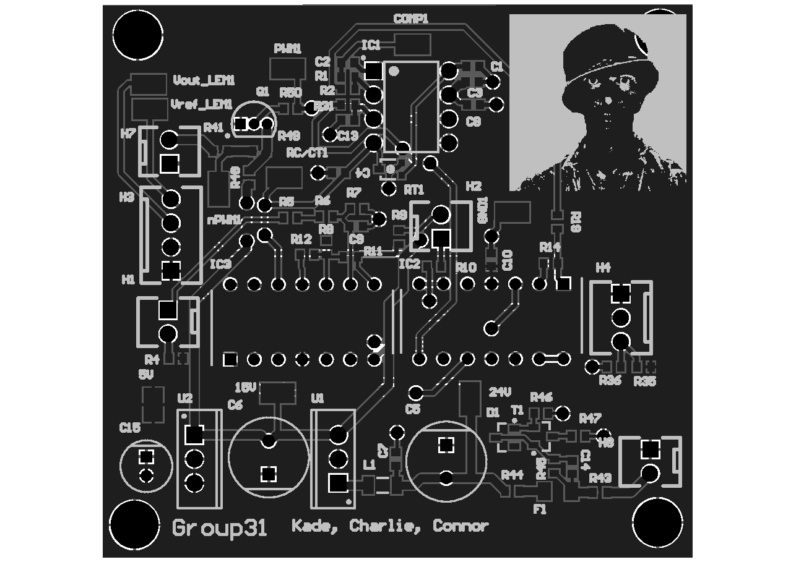
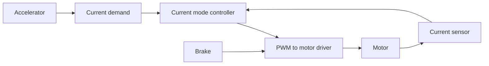

## Overview

This project is a closed-loop motor controller for a 3 kW, 24 V electric go-kart, designed in Altium. The accelerator sets the motor current, and therefore the torque, while the current is limited every switching cycle to protect the drive. The controller includes:
- Current mode control using a UC3843 PWM controller
- Overcurrent protection
- A brake circuit that immediately shuts the drive down
- 15 V and 5 V voltage regulation
- Test points for verification

The controller was built and verified on a test rig against all four inspection criteria.

## Table of Contents

- [Overview](#overview)
- [Table of Contents](#table-of-contents)
- [Control Overview](#control-overview)
- [Schematic Structure](#schematic-structure)
- [PCB Layout](#pcb-layout)

## Control Overview

## Schematic Structure
The Altium project in `gocart/` splits the design into one schematic sheet per subsystem: the accelerator input, current sensing, current mode controller, PWM inverter, brake circuit, voltage regulators, headers and test points. This kept each part of the circuit easy to review and test on its own.

## PCB Layout
The PCB was laid out compactly to keep traces short and current loops small, reducing noise coupling into the sensitive current-sense signals. The manufacturing outputs are in `gocart/Project Outputs for gocart/`.
